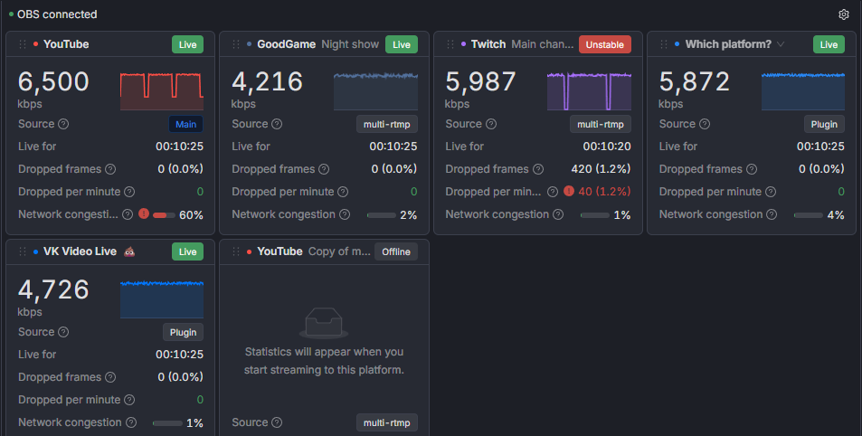

<p align="center">
  
</p>

<h1 align="center">StreamoScope</h1>

<p align="center">
  <strong>📡 Every live stream. One dock.</strong><br>
  Real-time stats for all active OBS streams — no matter what started them.<br>
  <sub>Made by <strong>Froghead Works</strong> 🐸 · Unofficial software. Officially useful.</sub>
</p>

<p align="center">
  <a href="https://github.com/tjnk24/streamoscope/releases">⬇️ Download</a> ·
  <a href="#-installation">📥 Install</a> ·
  <a href="#-what-you-can-see">👀 Features</a> ·
  <a href="#-limitations">🚧 Limitations</a> ·
  <a href="docs/TROUBLESHOOTING.md">🔧 Troubleshooting</a> ·
  <a href="https://github.com/tjnk24/streamoscope/issues">🐞 Report a bug</a>
</p>

> [!WARNING]
> 🧪 **Beta.** StreamoScope runs our streams and those of a few brave early adopters, but not every rough edge has been found yet. Spotted one? [Report it](https://github.com/tjnk24/streamoscope/issues) and it gets filed down. The installer backs up every OBS file it touches, just in case.
>
> 🐛 Thanks to [VideogamesSematary](https://www.twitch.tv/videogamessematary) on Twitch for helping catch the bugs.\
> Want to see your name here too? [Report bugs](https://github.com/tjnk24/streamoscope/issues), and ye shall be rewarded in full.

> [!NOTE]
> 🤖 Built with a lot of help from AI. A human set the course, tested it in real OBS and argued with the robot along the way. The bugs are a joint venture.

---

## 🔀 Your streams don't all come from the same place. Your stats should.

Running multiple streams from one OBS instance? You shouldn't have to open a separate stats panel for every plugin — or guess which stream is having a bad day.

**StreamoScope shows the live statistics of all running streams in a single OBS dock.** Whether an output comes from **OBS itself**, **obs-multi-rtmp**, or **another output plugin**, StreamoScope doesn't need to know your streaming setup in advance. It monitors the running outputs OBS exposes, not a fixed list of supported streaming plugins.

**No plugin loyalty.** 🤷

<p align="center">
  
</p>
<p align="center"><sub>Four streams, four sets of stats, one less reason to panic. 😌</sub></p>

## 🤔 Why StreamoScope?

- 📺 **All your streams, side by side.** See native OBS and third-party streaming outputs together, even when different plugins started them.
- 📈 **Live stats per output.** Check bitrate, recent bitrate history, dropped network frames, connection status, uptime and congestion without switching panels.
- 🆘 **Tells you what to try.** When a stream struggles, a red icon marks the row in trouble, and **What to do?** lists the fixes, naming OBS settings the way your OBS does.
- 🔌 **No plugin-specific setup.** StreamoScope is a monitor, not another multistream manager.
- 🧩 **Built into OBS.** A dock that stays where you work and adapts from a narrow column to a wide panel.
- 🩺 **Bonus: OBS and PC health.** Keep an eye on performance problems beyond your network connection.

The destination might be YouTube, Twitch, Kick, VK Video Live or somewhere else entirely. **How a stream was started isn't the point. Whether it's running — and how it's doing — is.**

## 👀 What you can see

| Every active streaming output | OBS and system |
| --- | --- |
| Current bitrate and two-minute graph | Total upload of all live streams, to hold against your internet upload speed (shown from two streams up) |
| Dropped network frames: total and recent | FPS, highlighted when it drops, and frame time |
| Live / dropping frames / unstable / reconnecting / offline status, with a hint on what to try | Encoding and rendering lag since the stream started, CPU usage and OBS memory |
| Uptime and network congestion | GPU usage, encoder load, VRAM and system RAM¹ |
| Detected platform and output source, when available | Diagnostics, mock mode, update checks and release notes right in the dock |

¹ Hardware readings come from the StreamoScope Lua bridge and are available on Windows.

- ⏳ **Cards wait for your first stream.** One short note until something goes live; obs-multi-rtmp targets get their empty cards right away. [More](docs/FEATURES.md#-cards-wait-for-your-first-stream)
- 🪞 **One key, two streams.** A plugin target that reuses the key of the main OBS stream gets a warning on its card. [More](docs/FEATURES.md#-one-key-two-streams)
- 🧲 **Your streams, your order.** Drag cards by the header; the dock remembers. [More](docs/FEATURES.md#-your-streams-your-order)
- 👓 **Only what you read.** Switch cards off and untick the rows you never look at in **Settings → Display**. [More](docs/FEATURES.md#-only-what-you-read)
- 🎨 **Dressed like your OBS.** Colours and font size follow the OBS theme. [More](docs/FEATURES.md#-dressed-like-your-obs)

🌍 The interface supports **English, Russian, Ukrainian, Spanish, German, French, Italian, Dutch, Polish, Brazilian Portuguese, Turkish, Vietnamese, Indonesian, Thai, Japanese, Korean and Chinese (Simplified and Traditional)**.

<p align="center">
  
</p>

> [!NOTE]
> StreamoScope monitors existing streams. It does **not** start streams, replace multistream plugins or fix your ISP. 🙃

## 📥 Installation

### 🪟 Windows installer (recommended)

**Requirements:** OBS Studio **28+**, with the built-in **obs-websocket 5** server; **64-bit Windows 10 or 11** for the installer.

1. Download the latest `streamoscope-setup-<version>.exe` from [Releases](https://github.com/tjnk24/streamoscope/releases).
2. **Close OBS**, then run the installer (no administrator privileges required).
3. Open OBS. If the dock isn't visible, go to **Docks → StreamoScope**.
4. On first launch, enter the OBS WebSocket port and password from **Tools → WebSocket Server Settings → Show Connect Info** (port `4455` by default).

🎉 **Done.** Start your streams however you normally do. StreamoScope watches the ones it can see through OBS — no need to select a separate integration for each output plugin.

The installer places files in `%LOCALAPPDATA%\Programs\streamoscope`, configures the dock and Lua bridge, keeps backups in `%LOCALAPPDATA%\streamoscope\backups`, and writes a setup log to `%LOCALAPPDATA%\streamoscope\configure-obs.log`. The log hides your Windows user folder, so you can attach it to an issue as it is; it still names your scene collections and profiles.

If OBS has never been launched on your PC, open it once, close it, then rerun the installer. You might need to enable its WebSocket server manually.

🔄 **Updates:** new versions download quietly in the background, signature checked, and start the next time you launch OBS. If one fails to start, the previous one comes back by itself. Prefer to stay in charge? Turn off **Update automatically** in the settings. [How updates work](docs/HOW-IT-WORKS.md#-updates)

🧹 **Uninstall:** close OBS and remove **StreamoScope** via **Windows Settings → Apps**. Backups of the OBS files it changed stay, just in case. [What it removes](docs/HOW-IT-WORKS.md#-uninstall)

### 📦 Manual / portable installation

1. Download `streamoscope-<version>.zip` from [Releases](https://github.com/tjnk24/streamoscope/releases) and extract it to a permanent folder.
2. In OBS, enable **Tools → WebSocket Server Settings → Enable WebSocket server**.
3. Go to **Docks → Custom Browser Docks** and point a new dock to `dock/index.html` using a `file:///` URL:

   ```text
   file:///C:/path/to/streamoscope/dock/index.html
   ```

4. Under **Tools → Scripts**, add `streamoscope-bridge.lua`, keeping its `streamoscope-bridge` support folder alongside it. OBS keeps scripts per scene collection, so add it to each collection you stream from.
5. Connect the dock using your OBS WebSocket port and password.

To update a manual installation, replace the files and refresh the dock with **Ctrl+R**.

## 🔍 How it finds streams

StreamoScope has two parts: the dock, which reads output statistics through OBS's built-in WebSocket server, and the **Lua bridge**, a small OBS script that supplies what WebSocket doesn't. It isn't tied to one particular multistream plugin or a preapproved list of destinations. The bridge passes only the protocol and host of each server and short fingerprints; stream keys stay in OBS. [How it works, with a diagram](docs/HOW-IT-WORKS.md)

## 🚧 Limitations

- **OBS must expose the output.** Plugin-independent does not mean API-independent: if an output plugin doesn't make an output or its statistics available to OBS, StreamoScope cannot invent the missing numbers. A plugin that only creates its output when streaming starts gets its card once that stream starts; the dock does not read private plugin configurations.
- **Outputs of the same name need the bridge.** Without it, several outputs a plugin names alike share one card with a warning: WebSocket asks about outputs by name and answers for one. With the bridge each gets its own card, kept in place by its fingerprint. Change a target's stream key or server and its card counts as new, so drag it back once.
- **Labels are best-effort.** The dock knows 27 platforms by name and colour: YouTube, Twitch, Kick, TikTok, Instagram, Facebook, X, Rumble, Steam, Trovo, W.TV, Rutube, VK Video Live, VK Video, OK, Boosty, GoodGame, Telegram, CHZZK, SOOP, Bilibili, niconico, Nimo TV, Picarto, Piczel.tv, Mixcloud and Vaughn Live. Any other destination still gets its card, titled with the service name or server host, and unrecognized plugin outputs can appear as **Plugin**.
- **VK Video, OK and Boosty share ingest servers.** There only the stream key tells them apart, and the dock never reads it. An obs-multi-rtmp target named after one of them (VK, ВК, OK, Boosty and the like) gets that platform. Any other card on those servers asks **Which platform?** right in its header and remembers the answer until its server or key changes; a guess from the target name can be overruled the same way.
- **Without the bridge, only the basics.** Bitrate, dropped frames and OBS statistics still work, but plugin outputs lose their platform names, outputs of the same name share a card, the same-key warning is gone, hardware readings (Windows only) disappear, the dock keeps its own dark colours instead of the OBS theme and updates have to be installed by hand.
- **Manual installs update manually.** Automatic updates work only in the installed version: replace the files yourself.

## ⚙️ Settings and privacy

Use the dock's **gear icon** to change language and colours, show or hide the stream cards and the OBS card and choose their rows, try mock mode, check for updates and read **What's new** without leaving OBS, turn automatic updates off, turn the journal off or copy diagnostics.

- To open the dock in a regular browser, copy **Dock address** from the settings and paste it there. Enter the WebSocket password again in the browser; the journal is kept only by the dock inside OBS.
- The OBS WebSocket connection normally uses `127.0.0.1`.
- Automatic updates, when enabled, contact `api.github.com` and download from GitHub on startup and roughly once per day; manual checks are also available. **What's new** loads the release notes from `api.github.com` when you open it.
- The WebSocket password stays in the dock's local browser storage. Stream keys never leave OBS: the bridge only folds them into the fingerprints of an output.
- Diagnostic exports exclude passwords, stream keys and server addresses.
- StreamoScope keeps a journal of what the bridge and the dock inside OBS do: connections, stream starts and stops, status changes, updates, errors, the buttons you press and, while you stream or record, bitrate and OBS statistics every 10 seconds. It stays in `%LOCALAPPDATA%\streamoscope\logs`, takes up to 10 MB, is never sent anywhere and contains no passwords, stream keys, server addresses, scene names or Windows user names. Turn it off in **Settings → Diagnostics**; uninstalling removes it.
- No separate StreamoScope account or cloud service is needed.

🔧 Something wrong with the dock, the installer or a stream? [Troubleshooting](docs/TROUBLESHOOTING.md) lists common problems and what the red icons on a card mean. Still stuck? [Open an issue](https://github.com/tjnk24/streamoscope/issues), preferably with **Settings → Diagnostics → Copy diagnostics** and the file `streamoscope.log` from **Open journal folder**.

## ✅ Verify downloads

Releases include **minisign signatures** and **SHA-256 checksums**. The Windows installer is currently **not Authenticode-signed**, so Windows SmartScreen may warn you. Verify your download before running it.

With the [public key](minisign.pub):

```bash
minisign -Vm streamoscope-setup-<version>.exe -p minisign.pub
```

Or compare the file hash with the release's `SHA256SUMS.txt`:

```powershell
Get-FileHash .\streamoscope-setup-<version>.exe -Algorithm SHA256
```

Replace `<version>` with the actual version in the download filename.

## 📜 License and credits

[MIT License](LICENSE). StreamoScope is an independent project, not an official OBS Studio product.

Uses [minisign](https://github.com/jedisct1/minisign) (ISC) and the [Inter font](https://github.com/rsms/inter) (SIL OFL 1.1).

---

<sub>🐸 <strong>Froghead Works</strong> · Independent Software Workshop · No unnecessary nonsense.</sub>
