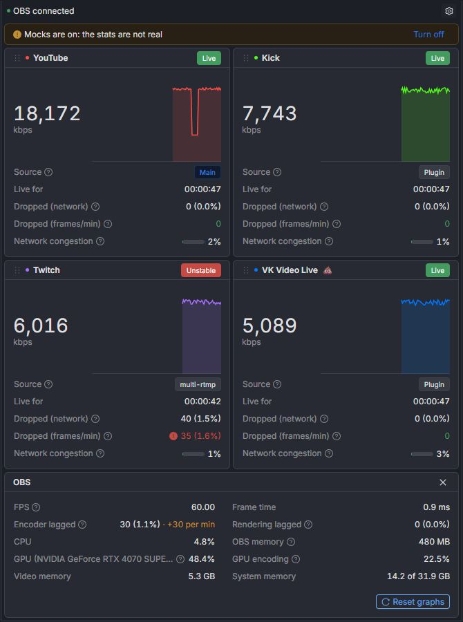
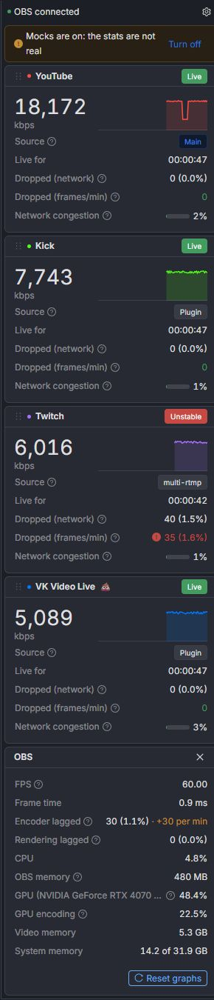

<p align="center">
  
</p>

<h1 align="center">StreamoScope</h1>

<p align="center">
  <strong>📡 Every live stream. One dock.</strong><br>
  Real-time stats for all active OBS streams — no matter what started them.<br>
  <sub>Made by <strong>Froghead Works</strong> 🐸 · Unofficial software. Officially useful.</sub>
</p>

<p align="center">
  <a href="https://github.com/tjnk24/streamoscope/releases">⬇️ Download</a> ·
  <a href="#-installation">📥 Install</a> ·
  <a href="#-what-you-can-see">👀 Features</a> ·
  <a href="#-limitations">🚧 Limitations</a> ·
  <a href="https://github.com/tjnk24/streamoscope/issues">🐞 Report a bug</a>
</p>

---

## 🔀 Your streams don't all come from the same place. Your stats should.

Running multiple streams from one OBS instance? You shouldn't have to open a separate stats panel for every plugin — or guess which stream is having a bad day.

**StreamoScope shows the live statistics of all running streams in a single OBS dock.** Whether an output comes from **OBS itself**, **obs-multi-rtmp**, or **another output plugin**, StreamoScope doesn't need to know your streaming setup in advance. It monitors the running outputs OBS exposes, not a fixed list of supported streaming plugins.

**No plugin loyalty.** 🤷

<p align="center">
  
</p>
<p align="center"><sub>Four streams, four sets of stats, one less reason to panic. 😌</sub></p>

## 🤔 Why StreamoScope?

- 📺 **All your streams, side by side.** See native OBS and third-party streaming outputs together, even when different plugins started them.
- 📈 **Live stats per output.** Check bitrate, recent bitrate history, dropped network frames, connection status, uptime and congestion without switching panels.
- 🆘 **Tells you what to try.** When a stream struggles, a red icon marks the row in trouble, and **What to do?** lists the fixes, naming OBS settings the way your OBS does.
- 🔌 **No plugin-specific setup.** StreamoScope is a monitor, not another multistream manager.
- 🧩 **Built into OBS.** A dock that stays where you work and adapts from a narrow column to a wide panel.
- 🩺 **Bonus: OBS and PC health.** Keep an eye on performance problems beyond your network connection.

The destination might be YouTube, Twitch, Kick, VK Video Live or somewhere else entirely. **How a stream was started isn't the point. Whether it's running — and how it's doing — is.**

## 👀 What you can see

| Every active streaming output | OBS and system |
| --- | --- |
| Current bitrate and two-minute graph | FPS, highlighted when it drops, and frame time |
| Dropped network frames: total and recent | Encoding and rendering lag since the stream started |
| Live / unstable / reconnecting status, with a hint on what to try | CPU usage and OBS memory |
| Uptime and network congestion | GPU usage, encoder load, VRAM and system RAM¹ |
| Detected platform and output source, when available | Diagnostics, mock mode, update checks and release notes right in the dock |

¹ Hardware readings come from the StreamoScope Lua bridge and are available on Windows.

⏳ **Ready before you go live.** The main OBS destination and streaming outputs already exposed by plugins get cards even while offline. Each card keeps its platform, source and place in your saved order, with a short waiting message instead of empty statistics. Start streaming and the same card shows live stats; reconnecting streams keep their statistics visible.

🧲 **Your streams, your order.** Drag a stream card by its header (the dotted handle shows up once there are two cards to sort) and the dock remembers where you put it. Until you do, the main OBS stream comes first. Changed your mind? **Restore default order** in the display settings.

🙈 **Not into OBS health today?** Close the OBS card with the ✕ in its corner. It waits for you in **Settings → Display → OBS card**, and the dock says so on the way out.

🌍 The interface supports **English, Russian, Spanish, German and Brazilian Portuguese**.

<p align="center">
  
</p>

> [!NOTE]
> StreamoScope monitors existing streams. It does **not** start streams, replace multistream plugins or fix your ISP. 🙃

## 📥 Installation

### 🪟 Windows installer (recommended)

**Requirements:** OBS Studio **28+**, with the built-in **obs-websocket 5** server; **64-bit Windows 10 or 11** for the installer.

1. Download the latest `streamoscope-setup-<version>.exe` from [Releases](https://github.com/tjnk24/streamoscope/releases).
2. **Close OBS**, then run the installer (no administrator privileges required).
3. Open OBS. If the dock isn't visible, go to **Docks → StreamoScope**.
4. On first launch, enter the OBS WebSocket port and password from **Tools → WebSocket Server Settings → Show Connect Info** (port `4455` by default).

🎉 **Done.** Start your streams however you normally do. StreamoScope watches the ones it can see through OBS — no need to select a separate integration for each output plugin.

The installer places files in `%LOCALAPPDATA%\Programs\streamoscope`, configures the dock and Lua bridge, keeps backups in `%LOCALAPPDATA%\streamoscope\backups`, and writes a setup log to `%LOCALAPPDATA%\streamoscope\configure-obs.log`. The log hides your Windows user folder, so you can attach it to an issue as it is; it still names your scene collections and profiles.

If OBS has never been launched on your PC, open it once, close it, then rerun the installer. You might need to enable its WebSocket server manually.

🔄 **Updates:** new versions download quietly in the background and start the next time you launch OBS. Nothing to click, nothing interrupts a stream. A small PowerShell script checks the minisign signature and unpacks the files next to the old version; it never runs a downloaded program. A new release reaches you automatically about two days after it's published, so a bad one can be pulled first. If a new version still fails to start, the previous one comes back by itself. Prefer to stay in charge? Turn off **Update automatically** in the settings and use **Check for updates** there.

🧰 **The installer still has a job:** two tiny files that OBS points at, the dock and bridge loaders, and the uninstaller live outside the updates and only change when you run the installer. Running the latest installer over your install is safe at any time: it keeps your settings and the journal. Since 0.7.0 the uninstaller takes its instructions from the version you have, so it rarely needs that. If a release does need the installer, its release notes say so first thing, and installs from before 0.7.0 get one polite request in the dock settings.

🗑️ **Uninstall:** close OBS and remove **StreamoScope** via **Windows Settings → Apps**. Nothing changes until you confirm: answer **No** and everything stays put. After **Yes** it takes the dock and the bridge script out of OBS, clears the bridge data from every profile and deletes the application folder, the journal and the updater state. Backups of the OBS files it changed (`%LOCALAPPDATA%\streamoscope\backups`) and `configure-obs.log` stay, just in case.

### 📦 Manual / portable installation

1. Download `streamoscope-<version>.zip` from [Releases](https://github.com/tjnk24/streamoscope/releases) and extract it to a permanent folder.
2. In OBS, enable **Tools → WebSocket Server Settings → Enable WebSocket server**.
3. Go to **Docks → Custom Browser Docks** and point a new dock to `dock/index.html` using a `file:///` URL:

   ```text
   file:///C:/path/to/streamoscope/dock/index.html
   ```

4. Under **Tools → Scripts**, add `streamoscope-bridge.lua`, keeping its `streamoscope-bridge` support folder alongside it. OBS keeps scripts per scene collection, so add it to each collection you stream from.
5. Connect the dock using your OBS WebSocket port and password.

To update a manual installation, replace the files and refresh the dock with **Ctrl+R**.

## 🔍 How it finds streams

StreamoScope has two parts: the dock, which reads output statistics through OBS's built-in WebSocket server, and the **Lua bridge**, a small OBS script that supplies what WebSocket doesn't. It isn't tied to one particular multistream plugin or a preapproved list of destinations.

The bridge tells the dock where plugin outputs are streaming, reads Windows hardware metrics and starts the background updates. The installer sets it up for you; the dock shows a notice whenever the bridge isn't loaded in the current scene collection. Missing metadata doesn't necessarily mean a stream isn't being monitored: some outputs may simply be labeled **Plugin**.

🔒 For platform detection, the bridge uses protocol and hostname information, not stream keys or URL paths.

## 🚧 Limitations

- **OBS must expose the output.** Plugin-independent does not mean API-independent: if an output plugin doesn't make an output or its statistics available to OBS, StreamoScope cannot invent the missing numbers. A plugin that only creates its output when streaming starts cannot have a waiting card beforehand; the dock does not read private plugin configurations.
- **Output identity may be ambiguous.** If a plugin reports several streams using indistinguishable output identifiers, OBS might not provide separate statistics for each one. StreamoScope displays what can be reliably distinguished.
- **Labels are best-effort.** Unrecognized services can appear as **Plugin** rather than a platform name.
- **Without the bridge, only the basics.** Bitrate, dropped frames and OBS statistics still work, but plugin outputs lose their platform names, hardware readings (Windows only) disappear and updates have to be installed by hand.
- **Manual installs update manually.** Automatic updates work only in the installed version: replace the files yourself.

## ⚙️ Settings, privacy and troubleshooting

Use the dock's **gear icon** to change language, show or hide OBS statistics, try mock mode, check for updates and read **What's new** without leaving OBS, turn automatic updates off, turn the journal off or copy diagnostics.

- To open the dock in a regular browser, copy **Dock address** from the settings and paste it there. Enter the WebSocket password again in the browser; the journal is kept only by the dock inside OBS.
- The OBS WebSocket connection normally uses `127.0.0.1`.
- Automatic updates, when enabled, contact `api.github.com` and download from GitHub on startup and roughly once per day; manual checks are also available. **What's new** loads the release notes from `api.github.com` when you open it.
- The WebSocket password stays in the dock's local browser storage. Stream keys are not read.
- Diagnostic exports exclude passwords, stream keys and server addresses.
- StreamoScope keeps a journal of what the bridge and the dock inside OBS do: connections, stream starts and stops, status changes, updates, errors, the buttons you press and, while you stream or record, bitrate and OBS statistics every 10 seconds. It stays in `%LOCALAPPDATA%\streamoscope\logs`, takes up to 10 MB, is never sent anywhere and contains no passwords, stream keys, server addresses, scene names or Windows user names. Turn it off in **Settings → Diagnostics**; uninstalling removes it.
- No separate StreamoScope account or cloud service is needed.

| Problem | Try this first |
| --- | --- |
| Dock is missing | **Docks → StreamoScope** |
| Can't connect | Enable OBS WebSocket; check port and password |
| Some platform names are generic | Check the Lua bridge is loaded in the active scene collection |
| GPU stats are missing | Check the Lua bridge on Windows |
| Installer didn't configure OBS | See `%LOCALAPPDATA%\streamoscope\configure-obs.log`; rerun with OBS closed |
| Dock asks to run the installer | Close OBS and run the latest `streamoscope-setup-<version>.exe` over your install; settings and the journal stay |

### 🩺 Stream problems

When a stream runs into trouble, a red icon lights up next to the row with the problem. Hover over it to see what's wrong; **What to do?** opens the steps below. The icon appears once the problem has lasted three seconds and goes out three seconds after it's over.

| Problem | Where the icon shows | Try this |
| --- | --- | --- |
| Frames are being dropped | **Dropped (frames/min)**: at least 1% of frames lost in the last minute | Lower the bitrate in **Settings → Output**; turn on dynamic bitrate in **Settings → Advanced → Network**; use a cable instead of Wi-Fi and pause other uploads; pick a closer server |
| The network is congested | **Network congestion**: the send buffer is at least half full | Same as for dropped frames: the network barely keeps up, and drops are next |
| OBS is reconnecting | Next to the status of the card | Check the internet connection; if it keeps dropping, pick another server; check on the platform's site that the stream hasn't ended there |
| The GPU is overloaded | **Rendering lagged**: at least 0.5% of frames in the last minute | Cap the game's FPS; run OBS as administrator; close other GPU-heavy apps; lower the base resolution or FPS in **Settings → Video** |
| The encoder can't keep up | **Encoder lagged**: at least 0.5% of frames in the last minute | Pick a faster preset in **Settings → Output**; switch from x264 to a hardware encoder (NVENC, AMF, Quick Sync); lower the output resolution or FPS |

🆘 Still stuck? [Open an issue](https://github.com/tjnk24/streamoscope/issues), preferably with **Settings → Diagnostics → Copy diagnostics** and the file `streamoscope.log` from **Open journal folder**. If the dock won't open, the file is in `%LOCALAPPDATA%\streamoscope\logs`. Please don't attach passwords or stream keys.

## 🧪 Build from source

Requires **Node.js 24+** (the current development server doesn't support Node 25).

```bash
git clone https://github.com/tjnk24/streamoscope.git
cd streamoscope
npm install
npm run build:prod
```

The built dock is in `build/`; the bridge is in `obs-script/streamoscope-bridge.lua`. For local development use `npm run start:dev` (default port `3062`); `npm test` runs lint and unit checks. Details: [Development and release notes](docs/DEVELOPMENT.md).

## ✅ Verify downloads

Releases include **minisign signatures** and **SHA-256 checksums**. The Windows installer is currently **not Authenticode-signed**, so Windows SmartScreen may warn you. Verify your download before running it.

With the [public key](minisign.pub):

```bash
minisign -Vm streamoscope-setup-<version>.exe -p minisign.pub
```

Or compare the file hash with the release's `SHA256SUMS.txt`:

```powershell
Get-FileHash .\streamoscope-setup-<version>.exe -Algorithm SHA256
```

Replace `<version>` with the actual version in the download filename.

## 📜 License and credits

[MIT License](LICENSE). StreamoScope is an independent project, not an official OBS Studio product.

Uses [minisign](https://github.com/jedisct1/minisign) (ISC) and the [Inter font](https://github.com/rsms/inter) (SIL OFL 1.1).

---

<sub>🐸 <strong>Froghead Works</strong> · Independent Software Workshop · No unnecessary nonsense.</sub>
