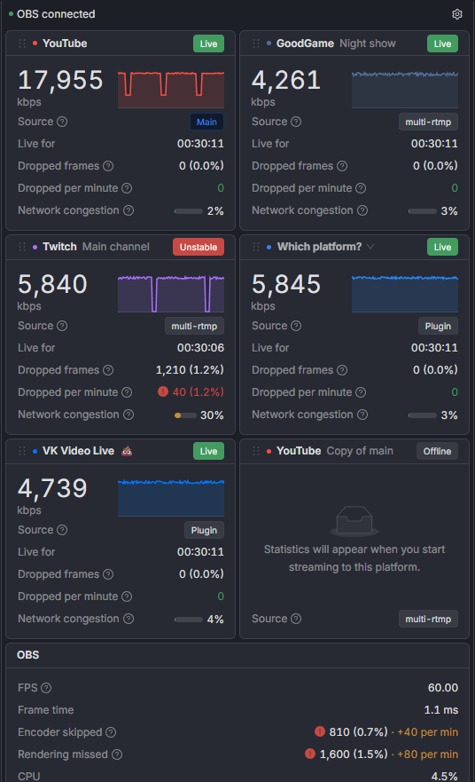

<p align="center">
  
</p>

<h1 align="center">StreamoScope</h1>

<p align="center">
  <strong>📡 Every live stream. One dock.</strong><br>
  Real-time stats for all active OBS streams — no matter what started them.<br>
  <sub>Made by <strong>Froghead Works</strong> 🐸 · Unofficial software. Officially useful.</sub>
</p>

<p align="center">
  <a href="https://github.com/tjnk24/streamoscope/releases/download/v0.15.0/streamoscope-setup-0.15.0.exe">⬇️ Download</a> ·
  <a href="#-installation">📥 Install</a> ·
  <a href="#-what-you-can-see">👀 Features</a> ·
  <a href="#-limitations">🚧 Limitations</a> ·
  <a href="docs/TROUBLESHOOTING.md">🔧 Troubleshooting</a> ·
  <a href="https://github.com/tjnk24/streamoscope/issues">🐞 Report a bug</a>
</p>

> [!WARNING]
> 🧪 **Beta.** It runs our streams and those of a few brave early adopters. Some rough edges are still out there. Found one? [Report it](https://github.com/tjnk24/streamoscope/issues). The installer backs up every OBS file it touches, just in case.
>
> 🐛 Thanks to [VideogamesSematary](https://www.twitch.tv/videogamessematary) on Twitch for helping catch the bugs.\
> Want your name here too? [Report bugs](https://github.com/tjnk24/streamoscope/issues), and ye shall be rewarded in full.

> [!NOTE]
> 🤖 Built with a lot of help from AI. A human set the course and tested it in real OBS. The bugs are a joint venture.

---

## 🔀 Your streams don't all come from the same place. Your stats should.

Running multiple streams from one OBS instance? You shouldn't have to open a separate stats panel for every plugin — or guess which stream is having a bad day.

**StreamoScope shows the live statistics of all running streams in a single OBS dock.** Whether an output comes from **OBS itself**, **obs-multi-rtmp**, or **another output plugin**, StreamoScope doesn't need to know your streaming setup in advance. It monitors the running outputs OBS exposes, not a fixed list of supported streaming plugins.

**No plugin loyalty.** 🤷

<p align="center">
  
</p>
<p align="center"><sub>Four streams, four sets of stats, one less reason to panic. 😌</sub></p>

## 🤔 Why StreamoScope?

- 📺 **All your streams, side by side.** See native OBS and third-party streaming outputs together, even when different plugins started them.
- 📈 **Live stats per output.** Check bitrate, recent bitrate history, dropped network frames, connection status, uptime and congestion without switching panels.
- 🆘 **Tells you what to try.** When a stream struggles, a red icon marks the row in trouble, and **What to do?** lists the fixes, naming OBS settings the way your OBS does.
- 🔌 **No plugin-specific setup.** StreamoScope is a monitor, not another multistream manager.
- 🧩 **Built into OBS.** A dock that stays where you work and adapts from a narrow column to a wide panel.
- 🩺 **Bonus: OBS and PC health.** Keep an eye on performance problems beyond your network connection.

The destination might be YouTube, Twitch, Kick, VK Video Live or somewhere else entirely. **How a stream was started isn't the point. Whether it's running — and how it's doing — is.**

## 👀 What you can see

**📡 For each stream**

- Bitrate now and a two-minute graph
- Dropped frames: total and recent
- Status: live, dropping frames, unstable, reconnecting or offline, with a hint on what to try
- Uptime and network congestion
- Platform ([27 known by name](docs/FEATURES.md#-platforms)) and which plugin sent it

**🖥️ For OBS and your PC**

- Total upload of all streams, to compare with your internet speed (from two streams up)
- FPS (highlighted when it drops) and frame time
- Encoding and rendering lag
- CPU and OBS memory
- GPU, encoder load, video memory and RAM (Windows only, through the StreamoScope Lua bridge)

**✨ And also**

- 🛠️ **Tools in the dock:** diagnostics, mock mode, update checks and release notes.
- ⏳ **Cards show up when streams start.** obs-multi-rtmp targets get their empty cards right away.
- 🪞 **Same key twice?** If a plugin stream uses the key of your main OBS stream, its card warns you.
- 🧲 **Drag cards to reorder them.** The dock remembers.
- 👓 **Hide what you don't read** in **Settings → Display**: whole cards or single rows.
- 🎨 **Looks like your OBS:** colours and font size follow the OBS theme.

More on each: [Features in detail](docs/FEATURES.md).

🌍 **Languages:** English, Russian, Ukrainian, Spanish, German, French, Italian, Dutch, Polish, Brazilian Portuguese, Turkish, Vietnamese, Indonesian, Thai, Japanese, Korean and Chinese (Simplified and Traditional).

<p align="center">
  
</p>

> [!NOTE]
> StreamoScope only watches streams. It doesn't start them, replace your multistream plugin or fix your ISP. 🙃

## 📥 Installation

### 🪟 Windows installer (recommended)

**You need:** OBS Studio **28+** and **64-bit Windows 10 or 11**.

1. [Download the latest version](https://github.com/tjnk24/streamoscope/releases/download/v0.15.0/streamoscope-setup-0.15.0.exe).
2. **Close OBS**, then run the installer.
3. Open OBS. No dock in sight? Go to **Docks → StreamoScope**.
4. Enter the WebSocket port and password from **Tools → WebSocket Server Settings → Show Connect Info**.
5. **Done.** Start your streams as usual. StreamoScope picks up whatever OBS can see.

🔄 **Updates install themselves** with the next OBS launch. A broken one rolls back by itself. You can turn them off in the settings. [How updates work](docs/HOW-IT-WORKS.md#-updates)

### 📦 Manual / portable installation

1. Download `streamoscope-<version>.zip` from [Releases](https://github.com/tjnk24/streamoscope/releases) and unpack it somewhere permanent.
2. In OBS, turn on **Tools → WebSocket Server Settings → Enable WebSocket server**.
3. In **Docks → Custom Browser Docks**, add a dock with this address, using your own folder:

   ```text
   file:///C:/path/to/streamoscope/dock/index.html
   ```

4. In **Tools → Scripts**, add `streamoscope-bridge.lua`. Keep its `streamoscope-bridge` folder next to it. OBS keeps scripts per scene collection, so add it to every collection you stream from.
5. Connect the dock with your WebSocket port and password.

Manual installs don't update themselves. To update, replace the files and press **Ctrl+R** in the dock.

## 🔍 How it finds streams

StreamoScope has two parts. The **dock** reads stream stats through OBS's built-in WebSocket server. The **Lua bridge** fills in what WebSocket can't tell. Neither cares which plugin started a stream or where it goes.

Stream keys stay in OBS. The bridge passes on only server hosts and short fingerprints that can't be turned back into a key. [How it works, with a diagram](docs/HOW-IT-WORKS.md)

## 🚧 Limitations

- **OBS has to see the stream.** If a plugin hides its output from OBS, StreamoScope can't make up the numbers.
- **The rest needs the Lua bridge.** Without it you still get bitrate, dropped frames and OBS stats, but no platform names for plugin streams, no separate cards for outputs with the same name, no same-key warning, no hardware stats, no OBS theme colours and no automatic updates. The installer sets the bridge up for you.

## ⚙️ Settings and privacy

The **gear icon** in the dock opens the settings: language, colours, which cards and rows to show, mock mode, updates, **What's new**, the journal and diagnostics.

Want the dock in a regular browser? Copy **Dock address** from the settings and paste it there, then enter the WebSocket password again.

Where your data goes:

- The dock talks to OBS on your own PC (`127.0.0.1`).
- The WebSocket password stays in the dock's local storage. Stream keys never leave OBS.
- GitHub is the only outside contact: for updates (at OBS startup and about once a day, if turned on, or when you check by hand) and for **What's new** when you open it.
- A journal of what the dock and the bridge do stays on your PC, up to 10 MB. It's never sent anywhere and has no passwords, keys or server addresses. Turn it off in **Settings → Diagnostics**. [What it records](docs/HOW-IT-WORKS.md#-the-journal)
- Copied diagnostics leave out passwords, stream keys and server addresses.
- No account, no cloud.
- To uninstall, close OBS and remove **StreamoScope** in **Windows Settings → Apps**. It takes the journal with it; backups of OBS files stay. [What it removes](docs/HOW-IT-WORKS.md#-uninstall)

## 🔧 Something wrong?

[Troubleshooting](docs/TROUBLESHOOTING.md) covers common problems and what the red icons on a card mean. Still stuck? [Open an issue](https://github.com/tjnk24/streamoscope/issues) and attach **Settings → Diagnostics → Copy diagnostics** and `streamoscope.log` from **Open journal folder**.

## ✅ Verify downloads

The installer isn't Authenticode-signed yet, so Windows SmartScreen may warn you. Every release comes with **minisign signatures** and **SHA-256 checksums**, so you can check the file before running it.

With minisign and the [public key](minisign.pub):

```bash
minisign -Vm streamoscope-setup-<version>.exe -p minisign.pub
```

Or compare the hash with `SHA256SUMS.txt` from the release:

```powershell
Get-FileHash .\streamoscope-setup-<version>.exe -Algorithm SHA256
```

Put your version in place of `<version>`.

## 🔨 Build from source

Want to build it yourself? [DEVELOPMENT.md](docs/DEVELOPMENT.md) has the steps.

## 📜 License and credits

[MIT License](LICENSE). StreamoScope is an independent project, not an official OBS Studio product.

Uses [minisign](https://github.com/jedisct1/minisign) (ISC) and the [Inter font](https://github.com/rsms/inter) (SIL OFL 1.1).

---

<sub>🐸 <strong>Froghead Works</strong> · Independent Software Workshop · No unnecessary nonsense.</sub>
