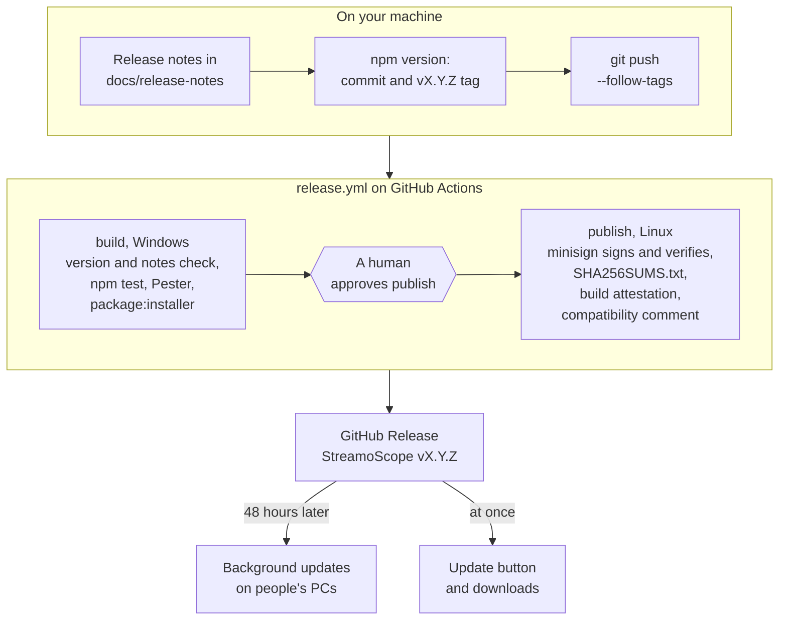
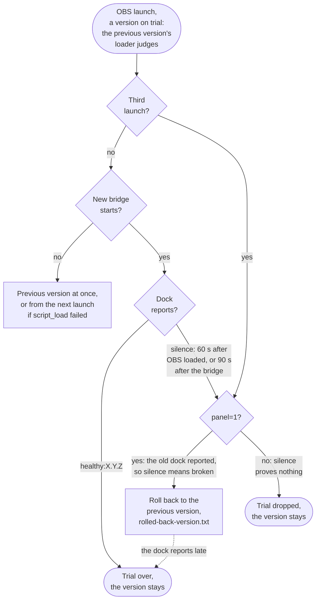

# StreamoScope — development and release notes

This document covers the build system, tests, installer and updater. If you just want to install StreamoScope, the [main README](../README.md) is less alarming.

## Requirements and local development

- **Node.js 24+**; the current dev server does not support Node 25.
- Windows and Inno Setup 6 for building the Windows installer.
- OBS Studio 28+ for integration testing.

```bash
git clone https://github.com/tjnk24/streamoscope.git
cd streamoscope
npm install
npm run start:dev
```

`npm run build:prod` puts the built dock into `build/`; the bridge is in `obs-script/streamoscope-bridge.lua`.

The development server uses `http://localhost:3062` by default. Set `PORT` in `.env` to choose another port. When OBS is available, the dev server can read WebSocket credentials from the OBS configuration and serve them locally. Mock mode allows interface development without a live stream.

| Command | What it does |
| --- | --- |
| `npm run start:dev` | Start the development server with hot reload |
| `npm run build:prod` | Create a production dock in `build/` |
| `npm run package:release` | Package release files and `compatibility.json` |
| `npm run package:installer` | Build the Windows installer; needs Inno Setup 6 (`ISCC_PATH` may point to `ISCC.exe`) |
| `npm run serve:test-release -- <folder>` | Host a local test release at `127.0.0.1:3063`; supports `--broken-signature` |
| `npm run test:installer` | Run Windows installer/updater checks with Pester 5 |
| `npm run test:bridge` | Run the Lua bridge and its rollback on the real LuaJIT from an OBS archive, with Pester 5 |
| `npm run test:stand` | Run the dock, a stream, updates and a rollback in a real portable OBS, see below |
| `npm run stand -- <command>` | Drive that OBS by hand; without a command it lists them |
| `npm run stand -- check-plugin` | Warn when obs-multi-rtmp has a newer release than the one the stand pins |
| `npm run lint` | TypeScript, ESLint, Stylelint and Knip checks |
| `npm run test:unit` | Run Vitest |
| `npm run test:e2e` | Build the dock and run the Playwright end-to-end tests in Docker, see below |
| `npm run test:e2e:update` | The same, but retake the reference screenshots and ARIA snapshots |
| `npm test` | Lint and unit tests |

The development server keeps its files in memory and leaves `build/` alone. Builds are cached in `node_modules/.cache/webpack`, so a repeat build takes a few seconds; delete that folder if a build ever looks stale.

Dependencies are updated by hand, in one batch about once a year. Dependabot only watches for vulnerabilities: a repository rule opens a pull request for a high or critical advisory in a package that ends up in the dock, and alerts for development tools are dismissed, since those never reach anyone's OBS. There is no `dependabot.yml`, on purpose. Workflows pin every action to a commit hash; `gh api repos/<owner>/<action>/commits/<tag> --jq .sha` gives the hash for a new version. CI installs with `npm ci --engine-strict`, so a package that does not run on the Node version from `.nvmrc` fails the build instead of sneaking in.

The project uses React 19, antd 6, Redux Toolkit, React Router 8, i18next, CSS modules, webpack and swc. Development conventions are in [`CLAUDE.md`](../CLAUDE.md), `.claude/rules` and `docs/internals` (in Russian).

## Card display checks

The main OBS destination and plugin outputs already exposed by OBS have cards before streaming starts. Offline cards show a waiting message and their source; live and reconnecting outputs show statistics. The same `main` and `plugin:<output name>` keys keep the saved drag order across state changes. Plugins that create outputs only when streaming starts cannot appear earlier. **Settings → Display** has a switch for the stream cards (`settings.isShowOutputCards`) and one for the OBS card (`settings.isShowGeneralCard`), both on by default; under each switch, while it is on, are checkboxes for the rows of those cards. `settings.hiddenOutputStats` and `settings.hiddenGeneralStats` store the unticked rows (default `[]`, no settings migration), so rows added later appear ticked. The cards themselves have no close button. The drag handle has no hover tooltip.

Before committing UI changes, run `npm run test:e2e`. For a look of your own, build with `npm run build:prod`, serve `build/` with the `dock-prod` configuration in `.claude/launch.json`, enable mocks in the isolated browser, and check at 300 and 670 px. Leave the user's running OBS alone.

## End-to-end tests

`npm run test:e2e` builds the production dock and opens `build/index.html` from disk, the way OBS does, in Playwright's Chromium at 300 and 670 px. The tests know nothing about the bundler: they need only what `npm run build:prod` leaves in `build/`. Before the page loads they put mock mode, English and the dark colors into its settings, stop the clock and seed `Math.random`, so the mock streams draw the same numbers and graphs on every run. They check that the dock connects to the mock OBS, that the stream cards and the OBS card appear before and after the streams start, that every settings group opens, and that turning mocks off sends the dock looking for the real OBS. Each test fails on a console error, an uncaught exception or any request to the network.

Reference screenshots and ARIA snapshots live next to the specs in `e2e/specs/<spec>/__snapshots__/<width>/`. Fonts render differently on Windows and Linux, so the tests always run in the `mcr.microsoft.com/playwright` image of the same version as `@playwright/test` (`scripts/e2e/runInDocker.ts`), locally and in CI; you need Docker, and no Playwright browser on the host. The first run pulls the image, about 1 GB. After an intended change in the interface, run `npm run test:e2e:update`, look at the new pictures in the diff and commit them with the change. A failed run leaves the report with screenshots, diffs and a trace in `playwright-report/`: `npx playwright show-report` opens it. CI keeps the same report for a week.

Nothing here touches a real OBS: the stand covers that.

## Releases and signed updates

To release a version:

1. Write `docs/release-notes/<version>.md`: English first, then `---` and Russian. The workflow fails without it.
2. Run `npm version <major|minor|patch>` to bump `package.json`, commit and create the `v<version>` tag.
3. Run `git push --follow-tags`.
4. When the build is done, approve the `publish` job on the page of the workflow run. Updates reach people without a click on their side, so this click is the last human check.
5. Once the release is published, point both README download links (the **Download** button and **Download the latest version** in the installation steps) at its installer, `https://github.com/tjnk24/streamoscope/releases/download/v<version>/streamoscope-setup-<version>.exe`, and push. GitHub has no version-free link to a versioned file, and before publication the link would lead nowhere.



The `v*` tag triggers the GitHub Actions release workflow: build, test, sign and publish. The `publish` job runs in the `release` environment, which needs that approval and accepts only `v*` tags. Published release assets:

| Asset | Purpose |
| --- | --- |
| `streamoscope-setup-<version>.exe` | Windows installer |
| `streamoscope-<version>.zip` | Dock, Lua bridge, updater and OBS setup scripts. Manual installs unpack it; the installed dock updates itself from it |
| `compatibility.json` | OBS, WebSocket, Chromium and bridge compatibility information |
| `.minisig` files | Signatures for released assets |
| `SHA256SUMS.txt` | Checksums for the installer and archive |

The `publish` job also records a GitHub build attestation for the installer, the archive and `compatibility.json`. It lives in GitHub rather than among the assets, and `gh attestation verify <file> --repo tjnk24/streamoscope` checks it. Releases up to 0.15.1 predate it.

The workflow appends a machine-readable `<!-- compatibility: {...} -->` comment to the published release notes; the dock reads it to decide whether an update is compatible. **Don't remove or rewrite it when editing the release on GitHub.**

Version numbers follow [Semantic Versioning](https://semver.org/). During the `0.x` series, minor versions may also change settings or installation steps; document those changes in the release notes.

Background updates replace only `versions\<version>`. If a release changes anything outside it (the bridge stub, the dock loader, the uninstaller code in `installer/streamoscope.iss`, the fallback `configure-obs.ps1`), start its release notes with a prominent "run the installer once" block in both languages. Otherwise the change reaches only people who install from scratch, which is a small and patient audience.

Only the release workflow builds a release, from a `v*` tag. Every other build, from `npm run start:dev` to `npm run package:installer` on your machine or CI on `main`, keeps the version from `package.json` and gets a build label from `git describe`, such as `v0.6.0-5-g4420f14-dirty`: five commits after `v0.6.0`, with uncommitted changes; outside a git checkout the label is `unknown`. The version itself stays a plain `X.Y.Z`, because the updater, the bridge and the loaders of old installs compare it. The label shows under the version in the dock settings, in **Copy diagnostics** and in the journal line about the dock start, and the installer becomes `streamoscope-setup-<version>-local.exe` with `StreamoScope (local build <label>)` in its wizard and in Windows Apps. The Apps entry keeps that name after a background update to a real release, and fairly so: the uninstaller and the loaders still come from the local installer until an official one runs.

CI runs checks and build tests on pushes to `main` and on pull requests. Manual workflow runs test the release process without publishing. A Husky pre-commit hook lints changed files and checks types.

### Urgent fixes

A release is a tag on `main`; there is no release branch, because the tag already says exactly what people have. When a released version needs a fix and `main` already holds unreleased work, branch from the tag:

```bash
git switch -c hotfix/0.6.1 v0.6.0
```

Fix it there, write `docs/release-notes/0.6.1.md`, run `npm version patch` and `git push --follow-tags -u origin hotfix/0.6.1`. The release workflow starts from the tag wherever it lives and runs the full build and tests before asking for approval; CI doesn't watch such branches. Then merge the branch into `main`, so the fix and the notes don't get lost, and delete it.

Fix only the newest released line. GitHub treats the release published last as the latest, and the dock, the updater and the Releases page all follow it: a 0.6.2 published after 0.7.0 would send new installs back to 0.6. An older line would need `--latest=false` in `release.yml`, which the workflow doesn't have. The workshop hopes never to need it.

## The journal

The bridge writes `%LOCALAPPDATA%\streamoscope\logs\streamoscope.log`. At 5 MB the file becomes `streamoscope.old.log`, replacing the previous one, so the journal never takes more than 10 MB. The bridge writes its own events and the statistics, even with the dock closed. The dock inside OBS sends its events to the bridge in batches every 10 seconds, errors at once, because each batch makes obs-websocket save the OBS profile file, and keeps its recent events, without statistics and up to 50 KB, for **Copy diagnostics**. The bridge writes its own events too, so the file still tells the story when the dock is broken. An installed dock in mock mode writes nothing, and one opened in a regular browser keeps its events only for its own diagnostics, so a second copy of the dock cannot double the lines. The development server writes only with mocks on, to `.dev-journal/streamoscope.log` in the project (ignored by git, cleared every time `npm run start:dev` starts); that file has no bridge lines or statistics, and **Open journal folder** opens its folder. Reading a report: each line is `time level source message`, `time` is local and the `loaded` line gives the UTC offset.

## Testing in a real OBS

`npm run test:stand` downloads a portable OBS and a local RTMP server (MediaMTX) into `.test-stand`, checks both against pinned SHA-256 hashes, and needs no OBS of your own. It leaves your OBS, scenes and stream keys alone: the portable copy keeps its settings in its own folder and streams only to `127.0.0.1`.

It installs the current code with the real `configure-obs.ps1` into a folder with Cyrillic in its path, then checks in OBS: empty cards for the obs-multi-rtmp targets before the first stream, the login, the health report, a stream with its bitrate in the dock, five outputs named `multi-output` filling those cards with a bitrate each, one of them reusing the main stream's key so the dock must warn about it and one going over SRT with its secrets in the address, which must never leave OBS, the **Update** button, a rollback from a broken dock and the background update. It takes about five minutes, opens an OBS window, and stops everything at the end.

The obs-multi-rtmp targets come from the real plugin: the stand downloads one pinned release from GitHub, checks its SHA-256 and puts it into the portable OBS only (`obs-plugins/64bit` and `data/obs-plugins` of that copy; the plugin's own installer would put it into `ProgramData`, which every OBS on the machine shares), with an `obs-multi-rtmp.json` in the stand profile whose targets start and stop with the main stream (`sync-start`) and stream to `127.0.0.1` with test keys. If the download fails or the hash doesn't match, the stand says so and falls back to its own script that imitates the plugin; `npm run test:stand -- --fake-multi-rtmp` does that on purpose. A newer plugin release is a reason to raise the pinned version and run the stand again: `npm run stand -- check-plugin` tells you when. Windows may ask about the firewall for this OBS; you can decline, since everything goes through `127.0.0.1`.

It reads the dock through the Chromium debugging port, so `npm run stand -- status`, `evaluate` and `screenshot` need neither the mouse nor the screen. The stand takes releases from a local test server: it doesn't replace a look at the real GitHub release or at the real installer.

The stand builds its test releases outside the project, in the neighbouring `streamoscope-test-builds` folder, with their own webpack cache, so they never touch `npm run start:dev` or `npm run build:prod`. You can delete that folder whenever the stand is not running.

## Testing the installer and the updater without publishing a release

`npm run test:stand` covers the updater. Use this flow for the installer itself. It uses a **separate test signing key and local update server**. Never commit the private key.

1. Generate a throwaway signing key outside the repository:

   ```bash
   minisign -G -W -p test.pub -s test.key
   ```

2. Build a test installer with `TEST_UPDATE_SERVER=http://127.0.0.1:3063` and `TEST_UPDATE_PUBLIC_KEY=<public key string>` set: `npm run package:installer`. These values affect the test build only.
3. Build a newer test version the same way, in a copy of the project with a raised `version`. Zip `release/streamoscope-<version>` so that this folder is the top level of the archive, put the zip and `compatibility.json` in the folder to serve, and sign both with `minisign -S -s test.key -m <file>`.
4. Run `npm run serve:test-release -- <folder>`, install the older test build and open OBS. About a minute later the bridge downloads the newer version by itself; **Check for updates** and **Update** in the settings do it at once. The test server reports an old publication date, so the two-day wait doesn't get in the way.
5. Restart OBS and check the version in the settings. Restore a production build afterward.

Use the `--broken-signature` option when you want to verify that the updater rejects a tampered package. The workshop considers this a desirable failure.

## How updates work

Updates work the way Chrome does them: the new version lands next to the old one and starts with the next launch of OBS.

```text
%LOCALAPPDATA%\Programs\streamoscope
  dock\index.html             loader, redirects to the current version
  streamoscope-bridge.lua     stub, runs the bridge loader of a version
  current-version.js          which version is current
  update-trial.txt            the new version is on trial, see below
  versions\<version>\         dock, bridge loader, bridge, updater and OBS setup scripts of that version
  configure-obs.ps1           fallback copy of the OBS setup script, comes only with the installer
  updater\minisign.exe        checks signatures, comes only with the installer
```

OBS keeps the paths of the dock loader and the bridge stub in its configuration, so they never move. Both are tiny and never change, so everything else updates with the version. The stub runs `versions\<version>\streamoscope-bridge.lua`, the full loader with the rollback logic. Until 0.7.0 the installer put that loader itself in the root, so installs set up by an older installer keep their old loader until a newer installer runs once.

About a minute after OBS starts and then once a day, the bridge starts `Update-Widget.ps1 -Auto`. It asks GitHub for the latest release at most once an hour, skips releases younger than 48 hours and major versions, then verifies and unpacks the archive. The last step is one atomic rewrite of `current-version.js`: a failure before it leaves the current version alone. The three newest versions and the one to roll back to stay on disk. The **Update** button runs the same steps through `-Version X.Y.Z`, without the wait.

The check also puts the running version back into the Windows Apps list if a rollback left it behind.

The switch **Update automatically** is stored by the bridge in `%LOCALAPPDATA%\streamoscope\auto-update.txt`, so the background check works even when the dock is closed or broken.

### Automatic rollback

A freshly switched version is on trial, and `update-trial.txt` names it and the previous version. The loader of the previous version judges it: that code has already proved itself, while the new version's own loader might be as broken as the rest of it. Once the trial is over, the stub runs the new version's loader. If a loader fails to load, the stub switches to the previous version of the trial, the last healthy version or the version whose loader worked last, marks the broken one as rolled back and runs that loader instead.

<details>
<summary>Diagram</summary>



</details>

- The bridge fails to load: back to the previous version at once, in the same session.
- The dock is healthy: a second after it finds the bridge, a dock inside OBS that hasn't hit a render error sends `healthy:X.Y.Z`. The bridge records it in `healthy-version.txt`, notes the OBS process in `healthy-process.txt` and ends the trial.
- No report 60 seconds after OBS says it finished loading (`OBS_FRONTEND_EVENT_FINISHED_LOADING`), or 90 seconds after the bridge loaded if that event never comes: back to the previous version right there, so the next launch is already fine. The wait is long on purpose. OBS creates a dock page when it gets round to it, on a busy PC some 20 seconds after loading, and the dock loader picks the version at that very moment, so a verdict before the page exists used to roll back perfectly healthy updates. A dock page that opened in time but reported late still undoes the rollback. The journal notes how many seconds after loading each dock reported (`dock reported healthy ... after_loading=14s`), so a report shows how close a PC comes to that minute. The wait belongs to the previous version's loader: installs of 0.10.0 and older still judge with their old 5 seconds, and with a slow dock the installer, which skips the trial, is the way past it.
- OBS crashes or keeps being closed before any of this: the third launch rolls back before the bridge even loads. Scene collection switches reload the script but don't count, because a launch is one OBS process.

If the previous version didn't report health in the OBS launch that downloaded the update, silence proves nothing, so the trial doesn't watch the dock (`panel=0`). The dock may have never connected, or it may be unticked in the **Docks** menu: OBS then doesn't start its page at all, while closing it with the X only lasts until the next launch. The rolled back version goes to `rolled-back-version.txt`: the background check skips it and anything older, and the settings card says what happened and offers to try it again with the button. A successful update clears the file.

A new bridge can meet an old dock: switching the scene collection reloads the scripts, while the open dock stays on its version. Bridge data therefore only gains fields.

## Installer and removal behavior

The installer puts application files in `%LOCALAPPDATA%\Programs\streamoscope` in the layout above, adds the OBS dock and Lua bridge, and attempts to configure the local WebSocket server. It keeps backups under `%LOCALAPPDATA%\streamoscope\backups` and writes `%LOCALAPPDATA%\streamoscope\configure-obs.log`.

Close OBS before installation or removal. Removal asks for confirmation first and only then takes the dock and the bridge out of OBS, together with the bridge data in every profile (the `[StreamoScope]` section of `basic.ini`). It leaves OBS WebSocket enabled because another application might rely on it. It deletes the application folder, the journal (`%LOCALAPPDATA%\streamoscope\logs`) with its setting and the updater state; installing or updating leaves the journal in place. The backups and `configure-obs.log` stay, so a removal that went wrong can still be undone and explained. A silent removal (`/VERYSILENT /SUPPRESSMSGBOXES`) with OBS open gets the default answers and quietly cancels itself without touching anything, so close OBS before scripting one.

Since 0.7.0 the uninstaller is thin. It runs `configure-obs.ps1` of the current version, so what removal takes out of OBS and which data it deletes arrive with background updates. Only the uninstaller itself, with its windows and a fallback list of files, comes from the last installer that ran. Installs set up by an older installer keep their old removal until a newer installer runs once.

The Windows executable does **not** currently have an Authenticode signature. Release assets are protected separately with minisign signatures and GitHub build attestations, and the README explains how to verify manual downloads.
