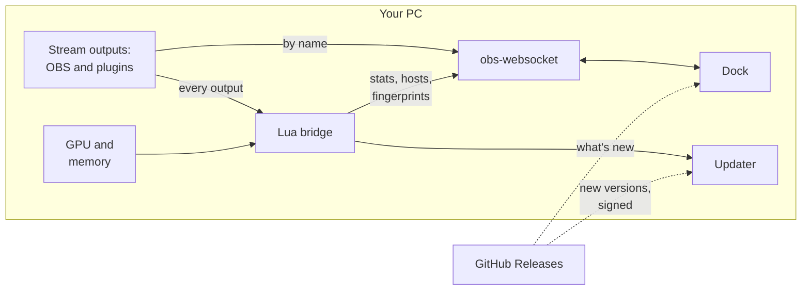
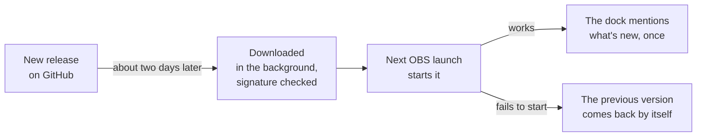

# StreamoScope — how it works

The [main README](../README.md) covers what StreamoScope does and how to install it. This page is about what happens behind the dock: how it finds streams, what the bridge passes along, how updates arrive and what uninstalling leaves behind.

## 🔍 How it finds streams

StreamoScope has two parts: the dock, which reads output statistics through OBS's built-in WebSocket server, and the **Lua bridge**, a small OBS script that supplies what WebSocket doesn't. It isn't tied to one particular multistream plugin or a preapproved list of destinations.

The bridge tells the dock where plugin outputs are streaming and how each of them is doing, reads Windows hardware metrics and starts the background updates. It hands its data to the dock through a profile parameter (`[StreamoScope]`), which the dock reads over WebSocket. The per-output numbers matter when a plugin gives all its outputs one name: obs-multi-rtmp calls every target `multi-output`, and WebSocket can only ask about an output by name, so it would answer for one of them. The bridge walks through all outputs instead, and every target gets its own card. The installer sets it up for you; the dock shows a notice whenever the bridge isn't loaded in the current scene collection. Missing metadata doesn't necessarily mean a stream isn't being monitored: some outputs may simply be labeled **Plugin**.

🔒 For platform detection, the bridge passes only the protocol and host of each server, never stream keys or URL paths. To tell outputs of the same name apart and keep their cards in place, it works out a short fingerprint from the server address and the stream key right inside OBS and passes only that. For obs-multi-rtmp targets that haven't started yet, it does the same with the server and key from the plugin's own settings in your profile. To spot a target that reuses the key of the main stream, it adds a second fingerprint made the same way from the key alone. Nothing is sent anywhere: the key stays in OBS, and the fingerprints can't be turned back into it. For the curious: HMAC-SHA256 cut to 8 characters, keyed with the ID Windows already keeps for this computer, so the same key gives a different fingerprint on any other machine.

## 🔄 Updates

New versions download quietly in the background and start the next time you launch OBS. Nothing to click, nothing interrupts a stream. A small PowerShell script checks the minisign signature and unpacks the files next to the old version; it never runs a downloaded program. A new release reaches you automatically about two days after it's published, so a bad one can be pulled first. If a new version still fails to start, the previous one comes back by itself. After an update the dock says so once, with a link to what's new. Prefer to stay in charge? Turn off **Update automatically** in the settings and use **Check for updates** there.

## 🧰 The installer still has a job

Two tiny files that OBS points at, the dock and bridge loaders, and the uninstaller live outside the updates and only change when you run the installer. Running the latest installer over your install is safe at any time: it keeps your settings and the journal. Since 0.7.0 the uninstaller takes its instructions from the version you have, so it rarely needs that. If a release does need the installer, its release notes say so first thing, and installs from before 0.7.0 get one polite request in the dock settings.

## 🧹 Uninstall

Close OBS and remove **StreamoScope** via **Windows Settings → Apps**. Nothing changes until you confirm: answer **No** and everything stays put. After **Yes** it takes the dock and the bridge script out of OBS, clears the bridge data from every profile and deletes the application folder, the journal and the updater state. Backups of the OBS files it changed (`%LOCALAPPDATA%\streamoscope\backups`) and `configure-obs.log` stay, just in case.
