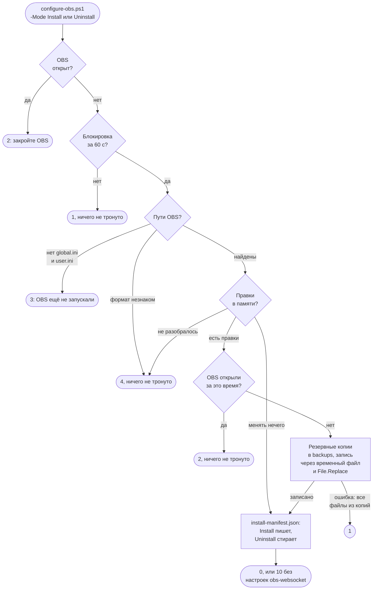
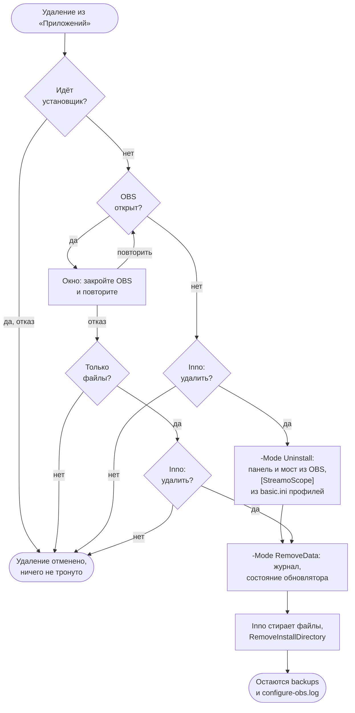

# Установщик и настройка OBS: как устроены

Форматы настроек OBS - `docs/obs-config.md` (новое знание о формате дописываем туда), правила PowerShell - `.claude/rules/windows/powershell.md`.

## Настройка OBS (PowerShell)

- **`installer/configure-obs.ps1` - точка входа** для Inno Setup.
  - `-Mode Install|Uninstall|Check|RemoveData`. `Check` - только проверка, открыт ли OBS, без записи. `RemoveData` стирает данные программы из `-DataDirectory` по `$script:RemovedDataItems` (`Remove-ProgramData`), не глядя на OBS (при «удалить только файлы» он открыт); что не стёрлось - в журнал, код `1`.
  - Ещё параметры: `-InstallDirectory`, `-ObsDirectory` (portable), `-ConfigDirectory`, `-DataDirectory`.
  - Код выхода `ConfigureObsResult`: `0` готово, `1` ошибка и откат, `2` OBS запущен, `3` OBS ещё не запускали, `4` незнакомый формат (ничего не тронуто), `10` готово, но настроек obs-websocket ещё нет.
  - На экран ничего не пишет: журнал - `%LOCALAPPDATA%\streamoscope\configure-obs.log`, резервные копии - `backups\<время>` рядом (последние 5).
  - Каждая строка журнала - с PID процесса: запуски, которые пережили снятый установщик, идут вперемешку. Первая строка - режим, папка, версия PowerShell, режим языка и Windows; на каждую коллекцию сцен - строка `Read:` с размером и временем разбора, чтобы зависание было видно по последней строке.
  - Журнал прикладывают к публичным issue, поэтому `Write-ConfigureLog` пропускает строки через `Hide-UserPath`: начало путей из `%LOCALAPPDATA%`, `%APPDATA%`, `%USERPROFILE%` (любой регистр, `\` и `/`) заменяется именем переменной. Имена коллекций и профилей остаются, о них предупреждает шаблон issue.
- **Функции - `installer/ConfigureObs/`**: `json/` (разбор с позициями, экранирование), `ini/`, `files/` (чтение и запись с проверкой, резервные копии, откат, журнал), `edits/` (правки настроек OBS), `paths/` (поиск OBS, portable, пути, запущен ли OBS); в корне - `Invoke-ConfigureObs`, `Get-ObsChanges`, `Enter-ConfigureLock`, `ConfigureObsResult`. Точка входа и тесты подключают их рекурсивно (`Get-ChildItem -Recurse`) от папки точки входа.
- **JSON разбирается по уровням.** `Read-JsonValue` отдаёт вложенный объект или массив только границами: его находит одно регулярное выражение .NET `$script:JsonContainer` (балансирующие группы, строки по правилам JSON, вне строк - только символы чисел, `true`, `false`, `null` и разделители). `Get-JsonMember` раскрывает узел и найденное значение на один уровень (`Expand-JsonValue`), так что коллекция сцен разбирается только по пути корень → `modules` → `scripts-tool` → `path`. Рекурсивный разбор всего файла на PowerShell 5.1 шёл около 19 с на мегабайт: в 0.8.1 человек с 48 коллекциями по ~760 КБ ждал 8 минут на «Настройка OBS...». Теперь мегабайт - около 0,1 с. Пропущенные части проверяются только на строки, допустимые символы и баланс скобок; тип закрывающей скобки сверяется на раскрытых уровнях.
- **С 0.7.0 `configure-obs.ps1` и `ConfigureObs/` - в архиве выпуска** (`scripts/packageRelease/copyReleaseFiles.ts`), лежат в `versions\<версия>\` и приходят с фоновым обновлением; установщик кладёт запасную копию в корень папки программы.
- **Порядок:** OBS закрыт (`Test-ObsRunning`) → блокировка `Local\streamoscope-configure-obs` (`Enter-ConfigureLock`: второй запуск ждёт до 60 с, потом код `1` без записи; блокировку снятого процесса забирает) → пути (`Resolve-ObsPaths`: portable, `[Locations]`, `user.ini` или `global.ini` по `docs/obs-config.md`) → все правки в памяти, ошибка разбора - выход без записи → ещё раз `Test-ObsRunning`: OBS открыли во время настройки - код `2` без записи → резервные копии → запись через временный файл с проверкой и `File.Replace` → при любой ошибке все файлы восстанавливаются из копий → `install-manifest.json` в папке установки (что добавлено, для повторной установки и удаления).

Схема

- **Повторная установка ничего не меняет.** Удаление убирает панель (по `uuid` или адресу), мост из всех коллекций и данные моста из `basic.ini` всех профилей (`[StreamoScope]` и `[ObsStatsDock]` - имя до 0.3.0, `Remove-IniSection`); сервер WebSocket не выключает.
- **Из массивов OBS** (`scripts-tool` в коллекции, `ExtraBrowserDocks`) удаление вырезает только свой элемент с соседней запятой (`Remove-JsonArrayItem`), чужие элементы - байт в байт.
- `user.ini` никогда не создаём, пароль obs-websocket не читаем и не пишем в журнал.

## Установщик (Inno Setup)

- **Иконка - `installer/images/`**: `streamoscope.ico` (`setup.exe`, деинсталлятор, запись в «Приложениях»; копируется в `{app}`), картинки мастера `wizard-<ширина>.png` (страница завершения) и `wizard-small-<размер>.png` (угол остальных страниц) в масштабах 100/150/200 %.
  - Та же иконка: `docs/images/streamoscope-icon-512.png` (README вместо баннера; из неё нарезаны остальные), `obs-script/streamoscope-bridge/icon.png` (описание моста в OBS), `src/images/streamoscope-icon.png` 64 px (фавикон - `favicon` у `HtmlWebpackPlugin`; в шапке панели иконки нет - решение пользователя).
  - Новая иконка - пересобрать все эти файлы из одного исходника.
- **`installer/streamoscope.iss`, сборка - `npm run package:installer`**: `package:release`, затем `scripts/buildInstaller` находит `ISCC.exe` (Inno Setup 6: `ISCC_PATH`, `%LOCALAPPDATA%\Programs`, `Program Files`) и передаёт `/DAppVersion`, `/DSetupName` (имя файла), `/DPackageDir` (папка выпуска), `/DOutputDir` и у сборки не из выпуска `/DBuildLabel` (метка `webpack/init/getBuildLabel`, `.claude/rules/releases.md`).
  - Результат - `release/streamoscope-setup-<версия>.exe`; у сборки с меткой - `streamoscope-setup-<версия>-local.exe`, а к `AppVerName` (мастер) и `UninstallDisplayName` («Приложения») дописывается ` (local build <метка>)`.
  - Номер версии прежний: из него собраны `versions\<версия>`, `current-version.js` и `DisplayVersion`.
- **`minisign.exe` для обновлятора** скачивает `scripts/buildInstaller/ensureMinisign.ts`: официальный архив по точной версии и SHA-256 из `scripts/buildInstaller/consts.ts`, распаковка встроенным `%SystemRoot%\System32\tar.exe` (GNU tar из Git zip не распаковывает), кэш - `node_modules/.cache/minisign/<версия>`. Бинарника в репозитории нет. Установщик кладёт его в `{app}\updater` с лицензией `installer/third-party/minisign-LICENSE.txt` (ISC). Меняем версию minisign - меняем версию и хэш в `consts.ts`.

## Раскладка установки

- `dock/index.html` - загрузчик панели из `installer/loader/index.html`: подставляет `current-version.js` и переходит на `../versions/<версия>/dock/index.html`, сохраняя `#`.
- `streamoscope-bridge.lua` - заглушка из `installer/loader/streamoscope-bridge.lua` (`docs/internals/bridge.md`).
- `current-version.js` - `window.STREAMOSCOPE_VERSION = 'X.Y.Z';`, читают оба загрузчика, установщик пишет в `WriteCurrentVersion`.
- `versions/<версия>/` - содержимое папки выпуска: панель, загрузчик моста и мост, `updater/`, `configure-obs.ps1` с `ConfigureObs/`.
- `updater/` - `minisign.exe` с лицензией.
- Файлы автоотката: `update-trial.txt`, `healthy-version.txt`, `healthy-process.txt`, `healthy-loader.txt` (версия, чей загрузчик последним загрузился без ошибки; пишет заглушка), `rolled-back-version.txt`.
- `ConfigureObs/` и `configure-obs.ps1` в корне - запасная копия от установщика.
- Адреса `dock/index.html` и `streamoscope-bridge.lua` записаны в настройках OBS и не меняются. Что вне `versions\` обновляет только установщик - `.claude/rules/releases.md`.

## Портативная установка

- **`streamoscope-portable-<версия>.zip`** - та же раскладка без установщика: заглушка, загрузчик панели, `current-version.js`, `versions/<версия>/`, `updater/minisign.exe` с лицензией, плюс `README.txt` (шаблон `scripts/packagePortable/README.template.txt`) и `LICENSE` в корне. Нет записи в «Приложениях», корневой копии `ConfigureObs/` (деинсталлятора нет) и иконки; OBS человек настраивает сам, как в README.
- **Собирает `npm run package:portable`** (`scripts/packagePortable`) из готовой `release/streamoscope-<версия>/` в `release/streamoscope-portable-<версия>/`; zip и подпись делает `publish` в `release.yml`. Раскладку пишет `writeInstallLayout`, ею же ставит программу стенд (`scripts/testStand/packaging/installCurrentVersion.ts`), поэтому стенд проверяет ровно то, что уходит людям. Раскладку установщика (`[Files]` в `streamoscope.iss`, `WriteCurrentVersion`) и `writeInstallLayout` меняем вместе.
- **`minisign.exe` - тот же, что у установщика** (`ensureMinisign`, официальная сборка по SHA-256). Человек скачивает его вместе с подписанным архивом, как `setup.exe`; обновлятор по-прежнему запускает только его, а не что-то из скачанного (решение пользователя).
- Обновлятор и мост отличий не замечают: `Set-UninstallDisplayVersion` без записи в «Приложениях» ничего не делает, версия OBS берётся из реестра, как у установщика (у portable OBS проверка `minObsVersion` пропускается).
- Данные (`%LOCALAPPDATA%\streamoscope`: статус обновления, журнал, `auto-update.txt`) - общие с установленной версией, если на компьютере есть обе.
- Обычный `streamoscope-<версия>.zip`, распакованный руками, работает без обновлятора (`update.available` - `false`): в нём нет заглушки и `minisign.exe`. Панель тогда пишет `update.noUpdater` с советом взять установщик или портативный архив.
- **`[InstallDelete]`** - старые файлы, все версии, `update-status.json` (иначе карточка показала бы статус несуществующей версии) и `update-check.stamp`: запуск установщика - чистая установка. Настройки панели и журнал остаются, повторная настройка OBS ничего не меняет, поэтому последний установщик можно запускать поверх в любой момент.
- **`[UninstallDelete]`** - всё, что Inno не ставил сам: `versions`, `current-version.js`, `install-manifest.json`, файлы автоотката, журнал, состояние обновлятора (`auto-update.txt`, `update-status.json` с `.lock`, `update-check.stamp`); это запасной путь, обычно их уже стёр `RemoveData`. `backups` и `configure-obs.log` остаются, чтобы после неудачного удаления вернуть настройки OBS и понять, что случилось.
- **Журнал установка не трогает**: `%LOCALAPPDATA%\streamoscope\logs` и `journal.txt` переживают установку и обновление, удаление их стирает (`-Mode RemoveData`, запасной путь - `[UninstallDelete]`).
- **`RemoveInstallDirectory`** на `usPostUninstall` стирает папку установки целиком, только если это обычная `{userpf}\streamoscope` (установку можно увести `/DIR=`, там стирается только список) - так уйдут и файлы, которые добавят будущие версии.
- Ctrl+R в доке перезагружает текущую версию из её папки, новая откроется при следующем запуске OBS: панель и мост всегда переключаются вместе. Настройки не теряются: у всех страниц `file://` в Chromium одно хранилище.

## Деинсталлятор и запуск настройки OBS

- **Установщик только запускает `configure-obs.ps1` скрыто** и переводит код выхода в текст: `2` - окно «закройте OBS и повторите попытку» по кругу, отмена - установка без настройки; `3`, `4`, `1`, `10` - пояснение на последней странице, там же всегда - где искать панель и пароль WebSocket. Каждый запуск пишет в журнал Inno строку до запуска (путь скрипта и режим) и код выхода.
  - **Запуск - `CreateProcessW` из `[Code]`, а не `Exec`**: у `Exec` нет тайм-аута, и пока жив `powershell.exe`, установщик ждал бы вечно с неактивной «Отменой». 64-битный `powershell.exe` без окна (`CREATE_NO_WINDOW`); перенаправление файловой системы выключается вызовом `Wow64DisableWow64FsRedirection`, потому что `Setup` 32-битный, а `EnableFsRedirection` Inno действует только на его собственные функции. Ожидание - `WaitForSingleObject` по 50 мс с прокачкой сообщений окна (`PeekMessage`), окно не «зависает».
  - Через 3 минуты (`SlowScriptMilliseconds`) - вопрос «подождать ещё?» (`ScriptSlow`, и при удалении). Да - ещё 3 минуты, нет или тихий режим - `TerminateProcess` и код `-1` (`ResultStopped`, только внутри установщика): на последней странице - `SetupStopped` с инструкцией и журналом, при удалении - обычное окно с ручной инструкцией. Запись идёт через временный файл и `File.Replace` после всего разбора, так что прерванный разбор ничего не меняет, а повторная установка доводит настройку до конца.- **Деинсталлятор тонкий (с 0.7.0)**: его код (`[Code]`, тексты окон, `[UninstallDelete]`, `RemoveInstallDirectory`) - от последнего запущенного установщика, фоновое обновление его не меняет, всю работу делает скрипт текущей версии.
  - `RunConfigureObs` читает версию из `{app}\current-version.js` (только цифры и точки), запускает `{app}\versions\<версия>\configure-obs.ps1` и явно передаёт `-InstallDirectory {app}`: по папке установки скрипт находит `install-manifest.json` и адреса панели и моста. Нет версии или её скрипта - запускает копию из корня.
  - Что убрать из OBS и какие данные стереть, решает текущая версия; следующие версии могут добавлять свои файлы в список `RemoveData`.
  - Установки установщика до 0.7.0 запускают корневой `configure-obs.ps1` своего установщика, пока не запустят новый; у поставленных установщиком 0.5.x удаление оставляет журнал и `healthy-process.txt` (в их списке этих файлов нет).
- **Установка и удаление не идут одновременно.**
  - **Установщик:** `SetupMutex=streamoscope-setup`, без `Global\`, потому что у каждого пользователя Windows своя установка. Второй установщик показывает окно `SetupAppRunningError`: его текст переопределён в `[Messages]` на всех языках установщика, потому что стандартный русский - «Обнаружен запущенный экземпляр Установка». Тот же текст выходит и для установщика, запущенного во время удаления; Inno показывает его ещё для `AppMutex`, но его у нас нет. В тихом режиме - «Отмена» и выход с кодом `1`. Inno создаёт и проверяет мьютекс после события `InitializeSetup`, так что код в нём от второго запуска не защищён.
  - **Деинсталлятор:** в начале `InitializeUninstall` проверяет тот же мьютекс (`CheckForMutexes`): окно `UninstallSetupRunning` по кругу, отказ отменяет удаление. Затем создаёт его сам (`CreateMutex`), и установщик, запущенный во время удаления, тоже останавливается.
  - Проверено тестовыми `setup`: установщик держит мьютекс на `ssPostInstall`, параллельно тихо запускаются второй установщик и кусок `InitializeUninstall`, и наоборот.
  - Снятый через Диспетчер задач установщик мьютекс отпускает, а `powershell.exe` может доработать в фоне. От этого защищает блокировка самого скрипта (`Enter-ConfigureLock`).
- **Порядок удаления:**
  - `InitializeUninstall` проверяет `-Mode Check`, открыт ли OBS: окно «закройте OBS и повторите попытку» по кругу; отказ - вопрос «удалить только файлы?», «нет» отменяет удаление. Он идёт раньше вопроса Inno «удалить?», и «нет» там оставило бы программу без панели и моста в OBS.
  - На `usUninstall` (после вопроса Inno и до удаления файлов) `-Mode Uninstall` убирает панель и мост (`RemoveFromObs`), следом `-Mode RemoveData` (`RemoveProgramData`, и при «удалить только файлы»), пока скрипт версии ещё на месте.
  - Ошибка или OBS, открытый между вопросом и удалением, - окно с ручной инструкцией и путём к журналу. Код `3` (нет `global.ini` и `user.ini`: OBS не запускали или настройки стёрты) - успех, убирать нечего.
  - `basic.ini` профиля, который не читается как UTF-8, удаление пропускает с записью в журнал, панель и мост всё равно убирает; нечитаемый `global.ini` - `4`, ничего не меняя.
  - Тихое удаление (`/VERYSILENT /SUPPRESSMSGBOXES`) при открытом OBS ответов не ждёт: окна получают ответы по умолчанию («отмена», затем «нет»), и удаление молча отменяется, ничего не тронув (решение пользователя). Поэтому скрипт перед ним закрывает OBS.

Схема

